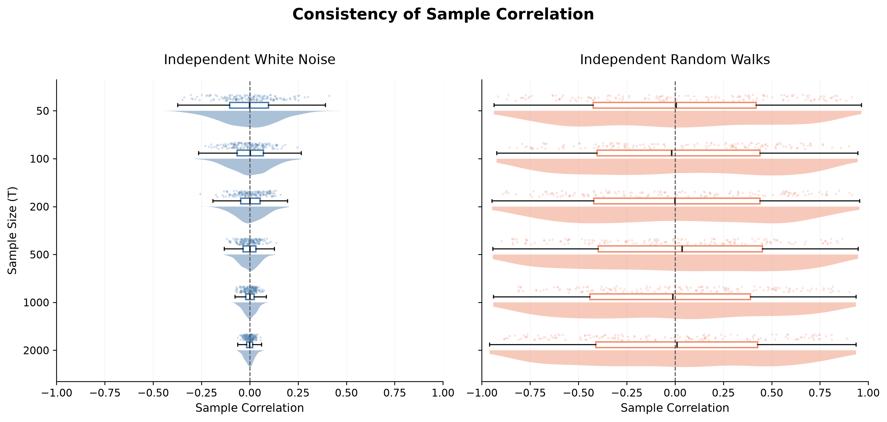
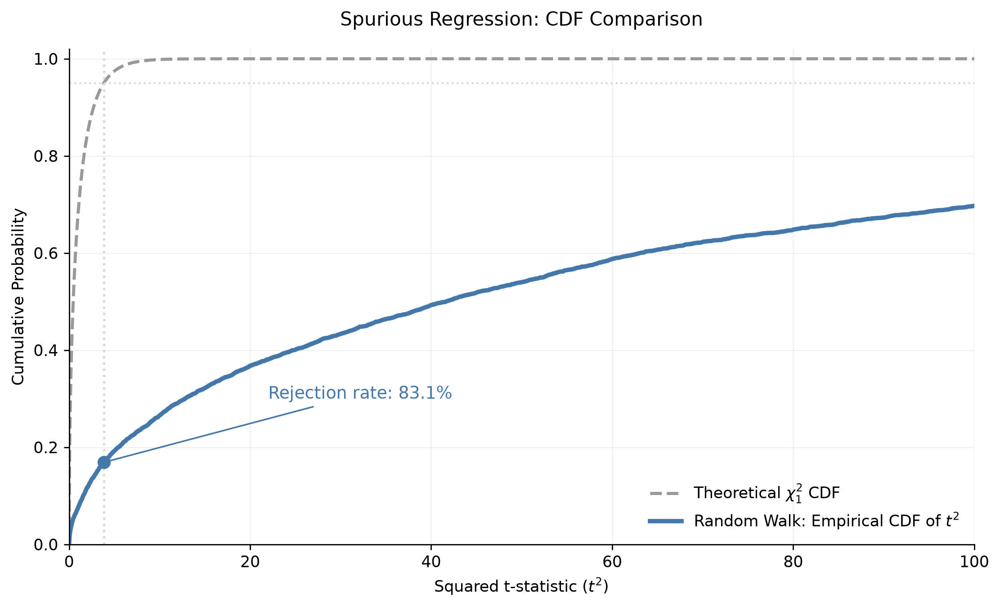

경제지표와 우리 회사 실적 사이에 어떤 관계가 있는지 알아보고 싶다고 하자. 가장 먼저 생각할 수 있는 방법은, 여러 경제지표와 실적 간의 상관계수를 계산하는 것이다. 그 중 상관계수가 높은 지표들을 골라내면, 실적과 밀접한 관계가 있는 경제지표를 찾았다고 생각하기 쉽다.

물론 상관관계와 인과관계가 다르다는 사실을 알고 있고, 인과관계를 당장 밝혀내기 힘드니, 차선으로 상관관계를 찾아내는 걸 알고있다. 그렇더라도, 두 변수의 상관계수가 높다는 사실 만으로 서로 관련되어있다고 말할 수 있을까? 즉,

> **우리가 계산한 상관계수는 믿을 만한 숫자일까?**

특히, 위의 케이스처럼 시간에 따라 변화하는 두 시계열의 경우에도, 우리가 계산한 표본상관계수가 원하는 방식대로 움직일 수 있을까?

---

## Correlated의 정의

확률공간 $(\Omega,\mathcal F,P)$ 위에서 정의된 두 확률변수 $X,Y$가 유한한 2차 적률을 가진다고 하자. 두 확률변수가 **uncorrelated**라는 것은 공분산이 0인 것으로 정의한다.

$$
X,Y\text{ are uncorrelated}
\iff \operatorname{Cov}(X,Y)=0.
$$

반대로, 공분산이 0이 아니라면, 두 확률변수는 correlated라고 한다. 당연히 알고있겠지만, 공분산이 0이라는 사실이 두 확률변수가 독립이라는 것을 의미하지는 않는다.

#### 여담 : $X$와 $X^2$의 상관관계

$X\sim N(0,1)$이고 $Y=X^2$라고 하자.

이때

$$
\begin{aligned}
\operatorname{Cov}(X,Y)
&=\operatorname{Cov}(X,X^2)\\
&=E[X^3]-E[X]E[X^2]\\
&=0.
\end{aligned}
$$

표준정규분포의 대칭성에 의해 홀수 차 적률이 0이라, 두 확률변수는 비상관이다. $Y$가 $X$에 의해 완전히 결정되므로 독립도 아니고, 일반적으로 생각하는 상관성과 살짝 대비되는 결과이긴 하다.

위에서내린 **correlated**의 정의는 상관계수가 두 변수 사이의 모든 의존관계를 나타내는 것이 아닌, 선형적인 의존관계를 측정한다는 점을 나타낸다.

---

## 공분산과 표본상관계수

앞서 언급한 **correlated**의 개념은 모집단의 특성을 나타낸다. 그러나 실제 분석에서는 두 확률변수의 결합분포를 알 수 없는 경우가 많으므로, 관측된 표본을 이용하여 추정한다. 표본상관계수는 다음과 같다.

$$
r_n
=
\frac{
\sum_{i=1}^{n}(X_i-\bar X)(Y_i-\bar Y)
}{
\sqrt{
\sum_{i=1}^{n}(X_i-\bar X)^2
\sum_{i=1}^{n}(Y_i-\bar Y)^2
}
}
$$

여기서 구분해야 할 것은 상관계수 $\rho_{XY}$와 표본상관계수 $r_n$의 차이다.

 - $\rho_{XY}$는 확률변수의 결합분포에 의해 결정되는 모집단의 상관계수다.

 - $r_n$은 관측된 표본으로 계산한 통계량이며, 표본에 따라 달라지는 확률변수다.

표본상관계수를 계산하는 목적은 결국 알 수 없는 모집단의 상관계수 $\rho_{XY}$를 추정하기 위한 것이다. 중요한 것은, 언제 표본상관계수가 모집단의 상관계수 $\rho_{XY}$를 제대로 추정하는가이다.

---

## 표본상관계수의 일치성

추정량 $\hat\theta_n$이 모수 $\theta$에 대해 일치성을 가진다는 것은 표본의 크기가 증가함에 따라 추정량이 모수로 확률수렴한다는 의미다.

$$
\hat\theta_n\xrightarrow{p}\theta.
$$

표본상관계수에 적용하면 다음과 같다.

$$
r_n\xrightarrow{p}\rho_{XY}
$$

이러한 일치성이 성립한다면 표본의 크기를 증가시킴으로써 모집단의 상관계수를 더 정확하게 추정할 수 있을 것이라고 기대할 수 있다.

---

### 독립·동일분포 표본에서의 일치성

$(X_i,Y_i)$가 동일한 결합분포에서 추출된 독립·동일분포(i.i.d.) 표본이라고 하자.

또한 다음 조건이 성립한다고 가정한다.

$$
E[X^2]<\infty,\qquad E[Y^2]<\infty
$$

$$
\operatorname{Var}(X)>0,\qquad
\operatorname{Var}(Y)>0.
$$

큰 수의 법칙에 의해

$$
\bar X\xrightarrow{p}E[X],
\qquad
\bar Y\xrightarrow{p}E[Y]
$$

이고,

$$
\frac{1}{n}\sum_{i=1}^{n}X_iY_i
\xrightarrow{p}E[XY]
$$

가 성립한다.

마찬가지로 표본 2차 적률도 모집단의 2차 적률로 수렴한다.

$$
\frac{1}{n}\sum_{i=1}^{n}X_i^2
\xrightarrow{p}E[X^2]
$$

$$
\frac{1}{n}\sum_{i=1}^{n}Y_i^2
\xrightarrow{p}E[Y^2].
$$

따라서 표본공분산과 표본분산은 각각 모집단의 공분산과 분산으로 수렴한다.

Continuous Mapping Theorem을 적용하면

$$
\begin{aligned}
r_n
&=
\frac{
\frac1n\sum_{i=1}^{n}X_iY_i-\bar X\bar Y
}{
\sqrt{
\left(\frac1n\sum_{i=1}^{n}X_i^2-\bar X^2\right)
\left(\frac1n\sum_{i=1}^{n}Y_i^2-\bar Y^2\right)
}
}
&\xrightarrow{p}
\frac{\operatorname{Cov}(X,Y)}
{\sqrt{\operatorname{Var}(X)\operatorname{Var}(Y)}}\
&=\rho_{XY}.
\end{aligned}
$$

결국 i.i.d. 표본과 적절한 적률 조건하에서 표본상관계수는 일치추정량이다. 실제로는, 적절한 stationarity 조건과, ergodicity 조건이 성립하는 시계열에서는 표본적률이 해당 모집단 적률로 확률수렴한다. 반대로, 이런 확률수렴 조건이 성립되지 않는다면 표본적률이 모집단 적률로 확률수렴하지 않고, 표본상관계수는 일치추정량이 아니게 된다.

---

## 서로 독립인 두 Random Walk

대표적인 예시는 두 Random Walk이다. 

$$
X_t=X_{t-1}+\varepsilon_t,\qquad
Y_t=Y_{t-1}+\eta_t
$$

여기서 $\varepsilon_t$와 $\eta_t$는 서로 독립인 평균 0의 i.i.d. 확률변수열이며, 초기값은 $X_0=Y_0=0$이라고 하자.

두 확률과정은 서로 독립이므로 모든 시점 $t,s$에 대해 다음이 성립한다.

$$
\operatorname{Cov}(X_t,Y_s)=0
$$

그런데 실제로 두 Random Walk를 생성하여 표본상관계수를 계산하면, 서로 독립인데도 상당히 큰 절댓값의 상관계수가 관측될 수 있다.

### Random Walk의 비정상성

Random Walk의 분산을 계산하면

$$
\begin{aligned}
\operatorname{Var}(X_t)
&=\operatorname{Var}\left(\sum_{i=1}^{t}\varepsilon_i\right)\
&=t\sigma_\varepsilon^2.
\end{aligned}
$$

즉, Random Walk의 분산은 시간에 따라 증가하므로, 약정상(weakly stationary) 시계열이 아니다. 이전에 언급하였던 표본적률이 모집단의 적률로 확률수렴하게 되는 조건을 깨버리는 상황이 나타나게 되었다. 실제로, 두 Random Walk의 표본상관계수는 다른 확률변수로 분포수렴한다.

서로 독립인 백색잡음과 Random Walk를 반복 생성하여 표본상관계수의 분포를 비교해보았다. 백색잡음의 경우, 상관계수가 표본 크기가 증가할 수록 점점 0으로 집중되지만, Random Walk는 그 분포가 넓게 유지된다.

 분포수렴 내용 

관측기간이 $T$일 때 두 Random Walk의 표본상관계수를 다음과 같이 정의하자.

$$
r_T=
\frac{
\sum_{t=1}^{T}(X_t-\bar X_T)(Y_t-\bar Y_T)
}{
\sqrt{
\sum_{t=1}^{T}(X_t-\bar X_T)^2
\sum_{t=1}^{T}(Y_t-\bar Y_T)^2
}
}
$$

모든 시점에서 두 확률과정이 독립이므로, 직관적으로는 $T$가 증가하면 $r_T$가 0으로 수렴할 것이라고 생각하기 쉽다.

하지만 실제로는 그렇지 않다.

함수형 중심극한정리(Functional Central Limit Theorem)에 의해 적절히 정규화한 Random Walk는 브라운 운동으로 약수렴한다.

$$
\frac{X_{\lfloor Ts\rfloor}}
{\sigma_\varepsilon\sqrt T}
\Rightarrow W_1(s)
$$

$$
\frac{Y_{\lfloor Ts\rfloor}}
{\sigma_\eta\sqrt T}
\Rightarrow W_2(s)
$$

여기서 $W_1,W_2$는 서로 독립인 표준 브라운 운동이다.

이를 표본상관계수에 적용하면 다음과 같은 비퇴화(non-degenerate) 확률변수로 분포수렴한다.

$$
r_T\Rightarrow
\frac{
\int_0^1\widetilde W_1(s)\widetilde W_2(s)ds
}{
\sqrt{
\int_0^1\widetilde W_1(s)^2ds
\int_0^1\widetilde W_2(s)^2ds
}
}
$$

단,

$$
\widetilde W_j(s) = 
W_j(s)-\int_0^1W_j(u)du
$$

이다.

여기서 주목할 점은 우변이 0이라는 상수가 아니라, 브라운 운동의 경로에 따라 달라지는 확률변수라는 것이다.

따라서

$$
r_T\not\xrightarrow{p}0
$$

이다.

두 Random Walk가 완전히 독립이고 모든 시점에서 공분산이 0임에도, 시계열에서 계싼한 표본상관계수는 표본의 크기가 증가한다고 해서 반드시 0에 가까워지지 않는다.

이것이 **허구적 상관(Spurious Correlation)**을 이해하는 데 중요한 사례이다. 표본상관계수의 계산이 잘못되었다는 뜻이 아니라, 계산된 표본상관계수를 두 확률과정 사이의 실질적 관계에 대한 증거로 해석하면 안된다는 의미이다.

---

## 허구적 회귀란?

이제, 두 시계열로 단순선형회귀를 수행한다고 해보자. 

$$
Y_t=\alpha+\beta X_t+u_t.
$$

절편을 포함한 단순선형회귀에서는 다음 관계가 성립한다.

$$
R^2=r_T^2.
$$

따라서 두 변수가 독립이더라도 표본상관계수가 크게 나타난다면, 회귀모형의 $R^2$ 역시 높게 나타날 수 있다.

그러나 문제는 여기서 끝나지 않는다.

독립적인 랜덤워크의 수준변수를 회귀하는 경우, 통상적인 OLS t-검정의 점근분포가 더 이상 적용되지 않는다.

서로 독립인 두 랜덤워크를 단순회귀한 뒤 얻은 $t^2$ 통계량의 경험적 CDF(파란색)를 이론적 $\chi_1^2$ CDF(회색)와 비교하였다. 5% 유의수준의 임계값 3.841에서 실제 기각률은 약 82.7%로 나타나, 독립인 변수들 사이에서도 통상적인 회귀검정을 적용하면 허위의 유의성이 대량으로 발생할 수 있음을 보여준다.

따라서 회귀계수가 통계적으로 유의하게 나타나더라도 그것을 두 변수 사이에 실제 관계가 존재한다는 근거로 받아들이기 어렵다.

이처럼 서로 관련이 없는 비정상 시계열 사이에서 겉보기에 의미 있는 회귀 결과가 나타나는 현상을 **허구적 회귀(Spurious Regression)** 라고 한다.

단순히 상관계수가 잘못 높게 나오는 데서 끝나지 않는다. 그 상관을 바탕으로 회귀를 돌리고 유의성까지 판단하는 순간, 아예 잘못된 기준으로 결론을 내릴 수 있다.

---

## 정리

표본상관계수는 두 변수의 관계를 요약하는 유용한 통계량이지만, 이에 파생하는 확률적 조건들을 무시하고 두 변수 사이의 실질적인 관계가 존재한다고 결론내리면, 큰 오류에 빠질 수 있다. 

**계산된 표본변수가 어떤 모집단의 특성을 추정하는지, 그 추정이 타당하다고 볼 수 있는 확률적 조건이 충족되는지를 검토해야한다.**