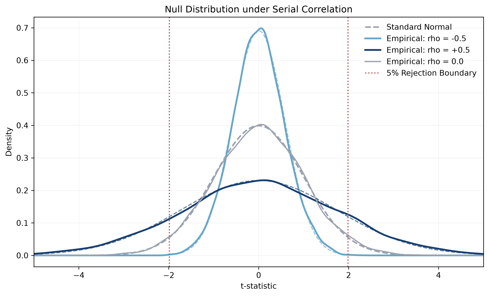

통계학을 배우다 보면 정규성(Normality)이 성립하는지에 대해서 많은 관심을 갖게 되는데, 한가지 놓치고 넘어가는 가정이 있다. 바로 **독립성(Independence)** 이다. 사실 많은 통계적 추론은 정규성이 조금 깨져도 상당히 강건(Robust)하지만, 독립성이 깨지면 표준오차(Standard Error) 자체가 잘못 계산되면서 검정 결과가 크게 왜곡될 수 있다.

---

## 평균을 추정할 때 우리가 알고 싶은 것

가장 단순한 상황을 생각해보자. 표본

$$
Y_1,Y_2,\cdots,Y_n
$$

이 있을 때, 우리는 평균

$$
\bar Y=\frac1n\sum_{i=1}^nY_i
$$

를 계산한다. 하지만 평균 자체보다 더 중요한 것은 **이 추정량이 얼마나 정확한가?** 이다. 표본평균의 정확도는

$$
Var(\bar Y)
$$

로 측정된다. 즉, 표본평균의 분산이 작을수록 평균 추정은 더 정확하다. 만약 모든 표본이 서로 독립이면

$$
Cov(Y_i,Y_j)=0
\qquad(i\neq j)
$$

이다. (반대는 성립하지 않는다!) 그러면 평균의 분산은

$$
Var(\bar Y)
=
\frac{\sigma^2}{n}
$$

이라는 아주 간단한 형태가 된다. 표본을 많이 모을수록, 표본평균은 더더욱 정확해진다. 그래서 그냥 생각하기에,  **표본만 많이 모으게 되면, 우리의 추정량이 정확해질 것이다** 라고 생각한다.

---

## 현실에서는 데이터가 독립일까?

하지만 현실은 그렇지 않다. 예를 들어 보험금 데이터를 생각해보자. 오늘 보험금이 많이 발생했다면 내일도 많이 발생할 가능성이 높다.

그 이유는

- 계절성
- 경기 상황
- 자연재해
- 사회적 이벤트

등이 하루 만에 사라지지 않기 때문이다. 오늘의 데이터와 내일의 데이터는 비슷한 정보를 담고 있다. 수식으로 표현하면

$$
Cov(Y_t,Y_{t+1})>0
$$

이다. 반대로 생각해보면, 오늘 지급될 보험금이 다 지급되었으니, 내일은 지급될 보험금이 없다고 한다면, 

$$
Cov(Y_t,Y_{t+1})<0
$$

라고도 생각할 수 있다. 이처럼 현실에서 나타나는 데이터가 독립이 아닌 경우는 빈번하다. 평균의 분산은 원래 이렇다. (간단히, 등분산을 가정하자.)

$$
\frac{\sigma^2}{n}
+
\frac{2}{n^2}\sum_{i<j}\operatorname{Cov}(Y_i,Y_j)
$$

독립이라면 모든 공분산(Covariance)이 0이므로 두 번째 항은 사라진다. 하지만 

**양의 자기상관(Positive Autocorrelation)** 이 존재한다면, 평균보다 큰 관측치 이후에 다시 큰 관측치가 나타날 가능성이 높다. 오차가 같은 방향으로 누적되면서 표본평균의 분산이 커질 수 있다.

반대로 **음의 자기상관(Negative Autocorrelation)** 이 존재한다면, 평균보다 큰 관측치 이후에 작은 관측치가 나타날 가능성이 높다. 오차가 서로 상쇄되면서 표본평균의 분산이 작아질 수도 있다.

상관계수를 $\rho$라고 하자.

$$
\begin{aligned}
\operatorname{Var}(\bar Y)
&=\operatorname{Var}\left(\frac{Y_1+Y_2}{2}\right)\
&=\frac{1}{4}\left(2\sigma^2+2\rho\sigma^2\right)\
&=\frac{\sigma^2}{2}(1+\rho).
\end{aligned}
$$

$\rho=0.5$라면 독립인 경우보다 분산이 1.5배 커지지만, $\rho=-0.5$라면 오히려 절반으로 줄어든다.

---

## 유효표본크기(Effective Sample Size)

이 현상을 이해하는 가장 좋은 개념이 **유효표본크기(Effective Sample Size)** 이다. 유효표본크기란 **관측치 사이에 의존성이 존재할 때, 동일한 표본평균의 분산을 얻기 위해 필요한 독립표본의 개수**를 의미한다. 

시계열의 자기상관이

$$
Corr(Y_i,Y_j)
=
\rho^{|i-j|}
$$

라고 하면,

충분히 큰 표본에서는

$$
Var(\bar Y)
\approx
\frac{\sigma^2}{n}
\cdot
\frac{1+\rho}{1-\rho}
$$

가 된다. 독립이 깨졌을 때, $\frac{1+\rho}{1-\rho}$는 평균의 분산이 얼마나 조정되는지 나타낸다.

표본크기가 100개일 때를 생각해보자.

| 자기상관계수 | 유효표본크기 |
|---|---:|
| $\rho=0.5$ | 약 33개 |
| $\rho=0$ | 100개 |
| $\rho=-0.5$ | 약 300개 |

양의 자기상관이 존재하면 실제 표본크기보다 유효표본크기가 작아지고, 음의 자기상관이 존재하면 더 커질 수도 있다.

물론 실제 관측치가 300개로 늘어났다는 뜻은 아니다. 표본평균의 분산을 기준으로 독립표본 300개와 비슷한 추정 효율성을 갖는다는 의미이다.

따라서 표본크기가 크다는 사실만으로 추정의 정확성을 판단할 수는 없다. 관측치들이 어떠한 의존구조를 갖고 있는지 함께 고려해야 한다.

---

## 표준오차의 왜곡과 가설검정

통계적 가설검정에서는 추정량 자체뿐만 아니라, 그 추정량이 얼마나 불확실한지를 함께 고려한다. 예를 들어 모평균에 대한 가설검정에서 사용하는 통상적인 표준오차인

$$
SE(\bar Y)
=
\frac{s}{\sqrt n}
$$

라는 공식은 사실상 모든 데이터가 서로 독립인 경우에 타당하다. (정확히는 공분산 항을 무시할 수 있는 상황에서 타당하다.) 하지만 관측치 사이에 자기상관이 존재한다면 실제 표본평균의 분산은 달라질 수 있다.

이를 확인하기 위해 귀무가설을

$$
H_0:\mu=\mu_0
$$

라고 하면, 통상적인 검정통계량은

$$
T=\frac{\bar Y-\mu_0}{s/\sqrt n}
$$

으로 계산한다.

여기서 분모에 있는 표준오차를 잘못 추정하면 검정통계량의 크기도 달라지게 된다.

양의 자기상관으로 인해 실제 표준오차가 더 큰 경우에는 이를 과소추정하게 된다. 그 결과 검정통계량의 절댓값이 과도하게 커지고, p-value는 지나치게 작게 계산되는 경향이 나타난다.

따라서 실제로 귀무가설이 참이더라도 이를 기각하는 제1종 오류(Type I Error) 가 증가할 수 있다.

반대로 음의 자기상관으로 인해 실제 표준오차가 더 작은 경우에는 이를 과대추정할 수 있다. 이 경우 검정통계량의 절댓값이 작아지고, 귀무가설을 기각하기 어려워지는 현상이 발생한다.

즉, **독립성을 잘못 가정하면 통계적 검정이 지나치게 관대해질 수도, 지나치게 보수적으로 변할 수도 있다.**

자기상관계수에 따른 검정통계량의 경험적 분포를 그려보았다. 점선은 이론적인 점근분포이며, 수직선은 독립성을 가정했을 시의 양측 5% 검정의 기각역이다.

독립성이 성립하는 경우($\rho=0$) 검정통계량은 표준정규분포에 가까운 형태를 보인다. 그러나 양의 자기상관($\rho=0.5$)이 존재하면 분포가 넓어지고, 음의 자기상관($\rho=-0.5$)이 존재하면 오히려 좁아진다.

양의 자기상관에서는 검정통계량이 기각역에 속할 가능성이 높아지며, 음의 자기상관에서는 그 가능성이 낮아진다.

---

## 정리

독립성은 단순한 수학적 가정이 아니다. 우리가 표본을 수집할 때, 각각의 관측치가 얼마나 새로운 정보를 제공하는지는 관측치 사이의 의존구조에 따라 달라진다. 

결국 독립성 위반의 핵심적인 문제는,

> **평균이 반드시 틀리는 것이 아니라, 평균의 불확실성(표준오차)을 잘못 계산할 수 있다는 것이다.**

이러한 문제를 해결하기 위해 자기상관과 이분산성을 고려하는 **HAC(Heteroskedasticity and Autocorrelation Consistent)** 와 같은 강건한 공분산 추정법이 활용된다.
